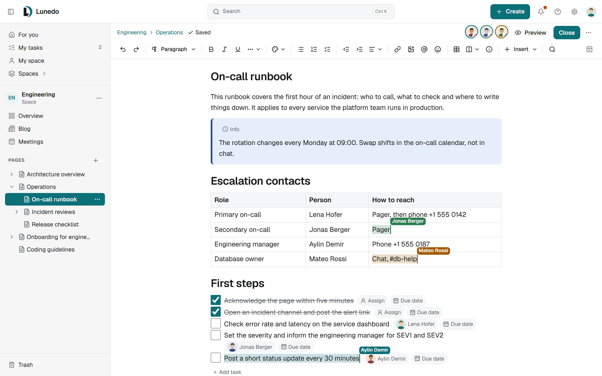

<p align="center">
  <picture>
    <source media="(prefers-color-scheme: dark)" srcset=".github/assets/lunedo-mark-dark.svg">
    
  </picture>
</p>

<h1 align="center">Lunedo</h1>

<p align="center">
  A self-hosted wiki and knowledge base for teams. Free software, every feature included.
</p>

<p align="center">
  <a href="https://lunedo.org">Website</a> ·
  <a href="https://lunedo.org/docs/">Documentation</a> ·
  <a href="https://lunedo.org/docs/admin/installation/">Install</a> ·
  <a href="CHANGELOG.md">Changelog</a>
</p>

<p align="center">
  <a href="https://github.com/lunedo/lunedo/releases/latest"></a>
  <a href="LICENSE"></a>
</p>

<picture>
  <source media="(prefers-color-scheme: dark)" srcset=".github/assets/screenshot-dark.png">
  
</picture>

## What Lunedo does

- **Pages and spaces.** A tree of pages, blog posts, meetings and whiteboards per space, with a block editor, tables, tasks and diagrams (draw.io, Mermaid, PlantUML, Excalidraw).
- **Real-time editing.** Several people edit the same page at once, with drafts and published versions.
- **Knowledge bases.** Articles for a help center, read in a portal of their own, with reviews and translations.
- **Search and permissions.** Search over everything a person may read; restrictions down to a single page, shares with people outside a space, confidential spaces administrators cannot open.
- **Sign-in your way.** Passwords with a second factor or passkeys, Microsoft Entra ID, Google Workspace, OpenID Connect, SAML, LDAP and SCIM.
- **Built to run yourself.** One Docker image, PostgreSQL as the only required database, encrypted backups, an audit log, a system check and Prometheus metrics.
- **Coming from Confluence?** Import a Confluence export or connect to its API.

Every feature is in every installation: no paid tiers, no license keys, no seat counting.

## Quick start

On a Linux host with Docker Engine 24 or newer:

```sh
curl -fsSLO https://github.com/lunedo/lunedo/releases/latest/download/install.sh && bash install.sh
```

The script asks for the installation directory and the address people open, starts Lunedo and prints a setup link. Then put a reverse proxy with TLS in front of it. The [installation guide](https://lunedo.org/docs/admin/installation/) covers your own Compose file, the [requirements](https://lunedo.org/docs/admin/requirements/) list what each size needs.

## Status

Lunedo 0.1 is the first public release. Expect changes between minor versions until 1.0; the changelog and the upgrade notes say what changed. Feedback and bug reports are welcome in the [issues](https://github.com/lunedo/lunedo/issues).

## Contributing

See [CONTRIBUTING.md](CONTRIBUTING.md). The [development docs](docs/development/) explain how to run Lunedo locally (`pnpm install && pnpm dev`), the repository layout and the checks that run in CI. Please report security issues privately as described in [SECURITY.md](SECURITY.md).

AI tools are used in the development of Lunedo. Every change is reviewed and tested by a maintainer before it is merged, and the maintainer is responsible for it.

## License

Lunedo is free software under the [GNU Affero General Public License v3.0](LICENSE). Contributions are accepted under the [Developer Certificate of Origin](CONTRIBUTING.md#developer-certificate-of-origin).
